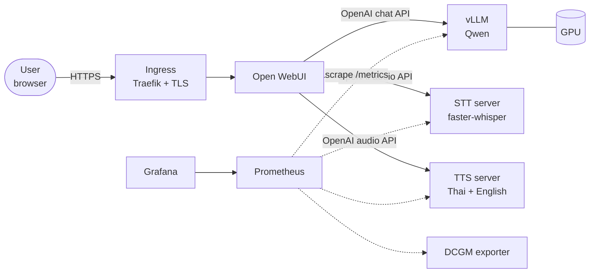

# vLLM-GenAI

A self-hosted, ChatGPT-style voice and text assistant that runs on consumer hardware.
The system uses vLLM for LLM serving, Kubernetes (k3s) for orchestration, and speaks Thai and English.

> **Status:** Early proof of concept. Work in progress. See [Milestones](#milestones).

## Why this project

In September 2026, I went to the vLLM Bangkok Meetup.
The talks covered high-performance serving on limited GPUs, KV-cache reuse with LMCache, and distributed inference with llm-d.
After the event, I wanted to understand these ideas by building a real system myself.

This repository is that system. It is a learning project first.
Every design decision and benchmark result goes into the docs, so other people can learn from it too.

## Goals

1. Serve an open LLM (Qwen) with vLLM, and understand each engine setting by measuring it.
2. Run the full stack on Kubernetes with a GPU: model server, web UI, speech, and monitoring.
3. Support voice conversation in **Thai** and English, with low latency.
4. Measure everything. Keep raw benchmark data and reproducible scripts in the repository.
5. Apply normal software engineering practice: tests, CI, pinned versions, and infrastructure as code.

## Target architecture



This diagram shows the target state. Some parts (for example Ingress with TLS) arrive in later milestones.

Data flow for one voice turn:

1. The browser records audio and sends it to Open WebUI.
2. Open WebUI sends the audio to the STT server. The STT server returns text.
3. Open WebUI sends the text to vLLM. vLLM streams the answer token by token.
4. Open WebUI cuts the stream into sentences. It sends each sentence to the TTS server while vLLM continues to generate.
5. The browser plays each audio chunk as it arrives.

## Hardware

| Machine | Role | Notes |
|---|---|---|
| MacBook Pro M1 Pro, 32 GB | Development loop | vLLM runs natively with [vllm-metal](https://github.com/vllm-project/vllm-metal). Other services run in k3d. No CUDA. |
| PC with RTX 4070, 12 GB (WSL2) | GPU target | k3s with the NVIDIA device plugin. Ada architecture (SM89), so fp8 weights and fp8 KV cache are available. |
| Cloud GPU (optional) | Large benchmarks | Use only when 12 GB of VRAM is not sufficient. Stop the instance after each session. |

## Technology stack

| Area | Choice | Reason |
|---|---|---|
| LLM serving | vLLM (CUDA), vllm-metal (Apple Silicon) | PagedAttention, continuous batching, OpenAI-compatible API |
| Model | Qwen3.5 small series (candidates: 2B, 4B, 9B) | Strong multilingual quality at small sizes |
| Orchestration | k3s (GPU node), k3d (Mac) | Lightweight Kubernetes for a single node |
| Manifests | Kustomize (base + overlays) | One set of manifests for Mac and GPU environments |
| Web UI | Open WebUI (pinned version) | ChatGPT-like UI with built-in voice mode |
| STT | faster-whisper, with a Thai fine-tuned Whisper candidate | Fast on CPU, Thai support |
| TTS | To be decided by benchmark (Thai candidates: MMS-TTS, KhanomTan, F5-TTS Thai) | Piper has no Thai voice |
| Monitoring | kube-prometheus-stack, DCGM exporter | Standard metrics, GPU metrics, dashboards as code |
| Tooling | mise, uv, pytest, GitHub Actions | Reproducible toolchain, tests, and CI |

## Milestones

| # | Milestone | Status |
|---|---|---|
| M0 | Repository setup: license, README, toolchain | In progress |
| M1 | vLLM standalone on Mac (vllm-metal) and on RTX 4070 (CUDA). Check model support first. Smoke tests for the OpenAI API. CI workflow. | Not started |
| M2 | Benchmark harness. Baseline numbers, including Qwen2.5-3B as a reference point against the T4 results of the reference project. One-by-one tests of engine settings (prefix caching, chunked prefill, speculative decoding, fp8). Thai quality checks. | Not started |
| M3 | Kubernetes: k3s with GPU on the PC, k3d on the Mac, Kustomize overlays, PVC storage | Not started |
| M4 | Open WebUI with text chat through vLLM | Not started |
| M5 | Voice: STT and TTS servers with an OpenAI-compatible API, Thai and English, sentence-level streaming | Not started |
| M6 | Observability: Prometheus, Grafana dashboards as code, metrics for STT and TTS, alerts | Not started |
| M7 | Hardening: Ingress with TLS, authentication, pinned images, prebuilt speech images | Not started |
| M8 | Advanced: LMCache, KV-aware routing (llm-d or vLLM production-stack), LoRA serving | Not started |
| M9 | Stretch: feedback collection and LoRA + DPO fine-tuning loop | Not started |

## Repository layout (planned)

```
.
├── k8s/
│   ├── base/            # Shared manifests
│   └── overlays/
│       ├── mac-dev/     # k3d on Apple Silicon, vLLM runs on the host
│       └── gpu/         # k3s on the RTX 4070 node
├── speech/
│   ├── stt/             # STT server (OpenAI audio API)
│   └── tts/             # TTS server (OpenAI audio API)
├── bench/               # Benchmark scripts, configs, and result summaries
├── tests/               # Smoke tests and integration tests
└── docs/                # Design decisions, setup guides, benchmark reports
```

## Quick start

Setup instructions come with milestone M1.

## Acknowledgements

This project is inspired by [PoonpipatChangkwain/vLLM-chatBOT](https://github.com/PoonpipatChangkwain/vLLM-chatBOT),
an end-to-end voice chatbot on a single T4 GPU.
That repository showed what a complete learning project looks like.
All code and documentation in this repository are written from scratch.

Thanks also to the vLLM community and the organizers and speakers of vLLM Bangkok.

## License

[Apache License 2.0](LICENSE)
