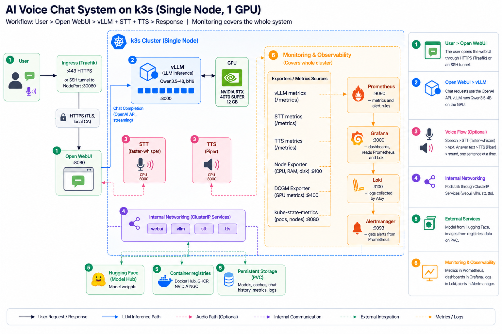

# vLLM GenAI: LLM Serving Infra (PoC)

A practice project for **LLM serving infrastructure**, end to end. It is a chatbot you can type to
or speak to, with a ChatGPT-like page and a voice mode. Open WebUI is the frontend. It connects to
a backend that follows the design of a production inference platform.

Everything runs on one machine with one GPU: a local PC with an **NVIDIA RTX 4070 SUPER (12 GB)**.
The same stack can run on a rented GPU machine (see [`docs/setup.md`](docs/setup.md), section "If
you run on EC2").

> **Status:** the code and the manifests are written. Part of the stack ran on the local PC, in WSL2
> (not yet on bare-metal Ubuntu or EC2). The rest is not tested yet. See "Status" at the end for
> what ran and what did not.

**Credit.** This project is inspired by
[PoonpipatChangkwain/vLLM-chatBOT](https://github.com/PoonpipatChangkwain/vLLM-chatBOT). The author
started it after the vLLM Bangkok meetup, to learn how an LLM serving stack works by building one.

---

## Overview



```
User (type or speak) -> Open WebUI (HTTPS through Traefik, or an SSH tunnel to NodePort :30080)
  -> [voice] STT (faster-whisper, CPU) -> text
  -> Service "vllm" -> vLLM pod (Qwen3.5-4B, GPU) -> answer (streamed)
  -> [voice] TTS (Piper, CPU) -> sound -> user
```

- **k3s** (a small Kubernetes) with one node runs the pods, connects them, and gives out the GPU.
- **vLLM** holds the GPU and serves Qwen3.5-4B (bf16, thinking mode off).
- **STT and TTS** run on the CPU only. They take no VRAM and stay always on.
- **Ingress**: Traefik with HTTPS from a local certificate authority.
- **Monitoring**: Prometheus, Grafana, Loki, Alertmanager, DCGM exporter, Node Exporter, and
  kube-state-metrics. `/metrics` on vLLM, STT, and TTS. The dashboard is stored as code.
- The **LLM-D router**, the **feedback pipeline**, and the **weekly retraining** are in the design
  but not built (see `CLAUDE.md`).

> To learn how a request moves through the system from the first click to the answer, read
> [`docs/GUIDE.md`](docs/GUIDE.md).

---

## Machine requirements

| Item | Target |
|---|---|
| Machine | Local PC, Ubuntu (bare metal) |
| CPU, RAM | AMD Ryzen 7 8700F (8 cores, 16 threads), 32 GB |
| GPU | NVIDIA RTX 4070 SUPER, 12 GB VRAM (Ada) |
| Disk | At least 100 GB free (model, container images, caches) |
| Other | `sudo` access. The desktop display also uses the GPU, so less VRAM is free. |

Run `kubectl` and the scripts from a second computer (a Mac in the author's case). The commands
that need `sudo` run on the PC.

---

## Setup

The full steps, with a check command after each step, are in [`docs/setup.md`](docs/setup.md).
This is the short version.

**1. Prepare the PC.** Install the NVIDIA driver, the NVIDIA Container Toolkit, Docker, and k3s.
Apply the device plugin. Check that the node shows one GPU.

```bash
kubectl apply -f k8s/nvidia-device-plugin.yaml
kubectl describe node | grep nvidia.com/gpu     # expected: nvidia.com/gpu: 1
```

**2. Run vLLM alone first (optional but advised).** It measures the real VRAM use and checks that
the model loads. See the section "vLLM standalone on the PC".

**3. Build and import the speech images.**

```bash
docker build -t genai-stt:0.1.0 speech/stt
docker build -t genai-tts:0.1.0 speech/tts
docker save genai-stt:0.1.0 | sudo k3s ctr images import -
docker save genai-tts:0.1.0 | sudo k3s ctr images import -
```

**4. Deploy vLLM, the speech pods, and Open WebUI.**

```bash
kubectl apply -f k8s/vllm-deployment.yaml -f k8s/vllm-service.yaml
kubectl apply -f k8s/speech-deployment.yaml
kubectl apply -f k8s/open-webui-deployment.yaml
kubectl rollout status deploy/vllm-qwen --timeout=20m
```

**5. Deploy monitoring.** Make the Grafana password Secret first (choose your own password).

```bash
kubectl apply -f k8s/monitoring/00-namespace.yaml
kubectl -n monitoring create secret generic grafana-admin --from-literal=admin-password='<your password>'
kubectl apply -f k8s/monitoring/
```

**6. (Optional) HTTPS.** Make a local certificate authority, trust it on your computer, and apply the
Ingress. See the section "Ingress with HTTPS".

**7. Open the pages through an SSH tunnel.**

```bash
ssh -L 8080:localhost:30080 -L 3000:localhost:30300 <user>@<pc-address>
```

Open `http://localhost:8080` (chat) and `http://localhost:3000` (Grafana, user `admin`). The address
is `localhost`, so the browser allows the microphone for voice mode.

---

## Smoke test

One script checks the whole stack in about one minute. It prints `PASS` or `FAIL` for each check and
ends with a non-zero exit code if any check fails.

```bash
sh bench/smoke_test.sh <pc-address>      # with HTTPS checks
sh bench/smoke_test.sh --no-https        # without the Ingress
```

It checks: a vLLM chat completion, a TTS to STT round trip ("hello world"), the Prometheus targets,
Loki, Alertmanager, and the HTTPS pages of Open WebUI and Grafana.

---

## Repo layout

| Path | What it is |
|---|---|
| `k8s/` | Manifests: vLLM, speech, Open WebUI, NVIDIA device plugin |
| `k8s/monitoring/` | Prometheus, Grafana, Loki, Alloy, Alertmanager, alert rules, exporters, dashboard |
| `k8s/ingress/` | HTTPS Ingress for Open WebUI and Grafana |
| `speech/stt/`, `speech/tts/` | The faster-whisper (STT) and Piper (TTS) servers |
| `vllm/` | Dockerfile of the vLLM image (it mounts the adapter folder) |
| `bench/` | Benchmark harness, lever script, quality check, dashboard generator, smoke test |
| `docs/` | `GUIDE.md`, `setup.md`, `benchmarks.md`, `workflow.png` (made with ChatGPT), `workflow.svg` (the same system drawn as code), `diagram-prompt.md` |
| `.scratch/` | The spec and the tickets of this project |

---

## Documents

- [`CLAUDE.md`](CLAUDE.md): the project overview and all design decisions.
- [`docs/GUIDE.md`](docs/GUIDE.md): how a request moves through the system, and how to read the dashboard.
- [`docs/setup.md`](docs/setup.md): the setup runbook, in order, with a check after each step.
- [`docs/benchmarks.md`](docs/benchmarks.md): the benchmark results (empty until the first measurement).

---

## Status

| Part | Status |
|---|---|
| GPU node: NVIDIA Container Toolkit, Docker, k3s, device plugin, GPU test pod | Ran on WSL2: the node reports `nvidia.com/gpu: 1` and a pod runs `nvidia-smi` |
| vLLM with Qwen3.5-4B (standalone, in Docker) | Ran on WSL2: chat, stream, tool calls, and thinking off work. VRAM measured (`docs/benchmarks.md`) |
| STT and TTS servers, `/metrics` routes | Tested in Docker on a Mac. Ran on k3s in WSL2: the round trip returned "Hello World!" |
| Open WebUI | Pod ready on k3s in WSL2, `/health` answers. Chat in the browser is not tested |
| vLLM on k3s, monitoring (Prometheus, Grafana, Loki, Alertmanager, exporters) | Applied on k3s in WSL2. The result was not checked. Config checks passed (`kubeconform`, `promtool`, `amtool`, `loki -verify-config`) |
| Voice mode in the browser, HTTPS Ingress | Written, not tested |
| Benchmark harness, lever script, smoke test | Written, logic tested with fake data. Not run on the cluster |
| Benchmark numbers (latency, throughput, levers) | Not measured yet |
| Thai TTS voice | Planned (bonus). Comparison scripts are written and not run |
| LLM-D router, scale-to-zero | Planned, not built |
| Feedback pipeline (Redis Streams) | Planned, not built |
| Weekly retraining (LoRA and DPO) | Planned, not built |

Next: finish the checks on the PC, then repeat them on bare-metal Ubuntu or EC2.

> This project is for practice of infra and scheduling. It is not a production system.
